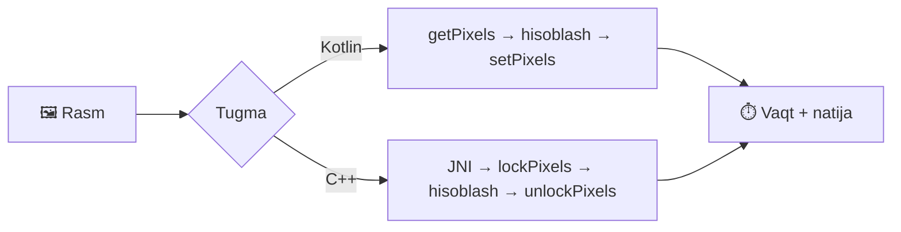

<div align="center">

# ⚡ NDK Grayscale Benchmark

**Kotlin vs C++ (Android NDK) — qaysi biri tezroq?**
Rasmni grayscale ga o'tkazish orqali ikkala yondashuvni real vaqtda o'lchaydigan Android ilova.

<br>


[Imkoniyatlar](#-imkoniyatlar) •
[Qanday ishlaydi](#-qanday-ishlaydi) •
[Ishga tushirish](#-ishga-tushirish) •
[Tuzilma](#-loyiha-tuzilmasi) •
[Nimalarni o'rgandim](#-nimalarni-organdim)

</div>

---

## 🎯 Loyiha haqida

Bu loyiha **Android NDK** va **JNI** bilan amaliy ishlashni ko'rsatish uchun yaratilgan. Bitta rasm ustida bir xil algoritm ikki usulda bajariladi va har birining vaqti ms da ko'rsatiladi:

| | 🟣 Kotlin | 🔵 C++ (NDK) |
|---|---|---|
| **Kirish usuli** | `Bitmap.getPixels()` / `setPixels()` | `AndroidBitmap_lockPixels()` |
| **Xotira** | Qator-qator nusxalash | To'g'ridan-to'g'ri piksel buferi |
| **Fayl** | `MainActivity.kt` | `native-lib.cpp` |

## 🎯 Skrinshot


## ✨ Imkoniyatlar

- 🖼️ **3 ta rasm** `RecyclerView` ro'yxatida
- ⚔️ Har bir rasm uchun **Kotlin** va **C++** tugmalari yonma-yon
- ⏱️ Aniq **vaqt o'lchash** (`measureTimeMillis`)
- 🔄 **Qayta tiklash** — barcha natijalarni bir bosishda asl holatga qaytarish
- 🧠 **Xotira tejash** — `inSampleSize` bilan ~1080×1080 gacha kichraytirib yuklash
- 🛡️ `OutOfMemoryError` va boshqa xatoliklardan himoya

## 🔬 Qanday ishlaydi



Grayscale yorqinlik (luminance) formulasi bo'yicha hisoblanadi, alfa kanal saqlanadi:

```
gray = 0.299 · R + 0.587 · G + 0.114 · B
```

<details>
<summary><b>🔗 JNI ulanishi (kodni ko'rish)</b></summary>

**Kotlin:**
```kotlin
external fun convertToGrayNative(bitmap: Bitmap)

companion object {
    init { System.loadLibrary("ndk") }
}
```

**C++:**
```cpp
extern "C" JNIEXPORT void JNICALL
Java_com_abdullojon_ndk_MainActivity_convertToGrayNative(JNIEnv* env, jobject, jobject bitmap) {
    AndroidBitmapInfo info;
    void* pixels;
    AndroidBitmap_getInfo(env, bitmap, &info);
    AndroidBitmap_lockPixels(env, bitmap, &pixels);
    // piksellarni qayta ishlash...
    AndroidBitmap_unlockPixels(env, bitmap);
}
```

</details>

## 🚀 Ishga tushirish

### Talablar

- Android Studio (so'nggi barqaror versiya)
- **NDK (Side by side)** va **CMake 3.22.1** — *SDK Manager → SDK Tools*
- JDK 11+
- Android 7.0+ (API 24) qurilma yoki emulyator

### O'rnatish

```bash
git clone https://github.com/<username>/<repo>.git
cd <repo>
./gradlew assembleDebug
```

Yoki Android Studio da: **File → Open** → loyihani tanlang → **Run ▶**

## 📱 Foydalanish

1. Ilovani oching va rasmlar ro'yxatini ko'ring
2. **Kotlin** yoki **C++** tugmasini bosing
3. Grayscale natija va `TIME: N ms` ni solishtiring
4. Yuqori o'ngdagi **Qayta tiklash** bilan qaytadan boshlang

<!-- 📸 Skrinshot qo'shing:
<p align="center">
  
</p>
-->

## 📁 Loyiha tuzilmasi

```
NDK/
├── app/src/main/
│   ├── cpp/
│   │   ├── native-lib.cpp        # C++ grayscale (JNI)
│   │   └── CMakeLists.txt        # libndk.so build
│   ├── java/com/abdullojon/ndk/
│   │   └── MainActivity.kt       # UI + Kotlin grayscale + JNI chaqiruvi
│   └── res/                      # layout, menyu, rasmlar, mavzular
├── build.gradle.kts
└── settings.gradle.kts
```

## 🧰 Texnologiyalar

| Soha | Texnologiya |
|---|---|
| Til | Kotlin, C++ |
| Native | Android NDK, JNI, `jnigraphics` |
| Build | Gradle (Kotlin DSL), CMake 3.22.1 |
| UI | RecyclerView, ViewBinding, Material Components, ConstraintLayout |

## 🎓 Nimalarni o'rgandim

- [x] **Android NDK** va **CMake** bilan native kutubxona (`libndk.so`) yaratish
- [x] **JNI** orqali Kotlin ↔ C++ o'rtasida ma'lumot almashish
- [x] `jnigraphics` bilan `Bitmap` piksellariga native darajada kirish
- [x] Kotlin va C++ samaradorligini `measureTimeMillis` bilan o'lchash
- [x] Katta rasmlarda xotirani boshqarish (`inSampleSize`, `OutOfMemoryError`)
- [x] `RecyclerView`, `ViewBinding` va Material Components bilan UI

## 👤 Muallif

**Abdullojon Farmonov**

**farmonovabdullojon04@gmail.com**

<div align="center">

⭐ Loyiha foydali bo'lsa, yulduzcha qo'yishni unutmang!

</div>
